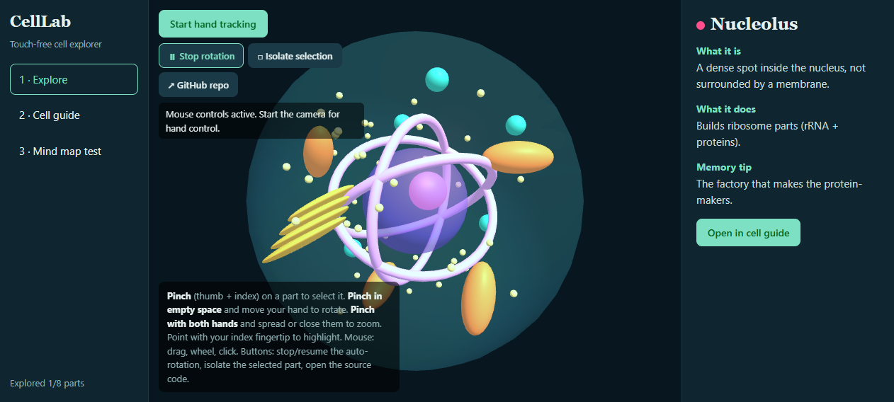

# 🦠 Cellab — v1

**Touch-free 3D cell explorer.** Rotate, zoom and select the parts of an animal cell using only your webcam and your hands. No controller, no install, no account, no server — one HTML file.

> 🔬 **Live demo:** https://cellab.vercel.app
> 📦 **This is version 1 — Cellab.** The second iteration, **Celly (v2)**, is already scoped: Blender-rigged 3D hands, hand control on every page, offline bundling and more (see [Roadmap](#-roadmap-cellab-v1--celly-v2)).



---

## ✨ What it is

Cellab turns the flat, passive cell diagram from a biology textbook into a **real-time 3D object you can grab with your empty hands**. Point at the mitochondrion, pinch, and the app tells you what it is, what it does, and how to remember it. Pinch in empty space and sweep your hand — the cell rotates. Spread both hands — it zooms.

It comes out of a written thesis: **[“From RGB Camera to 3D Interaction: How Controller-Free XR Could Transform Learning”](https://medium.com/@ulrichtapsoba)** (Medium, 2026). The argument: human brains learn best through patterns they already know — grabbing, turning, looking at things. Standard education forces learners to *imagine* those visuals instead of *experiencing* them. Controller-free XR restores the natural loop, and Cellab is the minimal, honest proof-of-concept of that idea: no headset, no controllers, no cost — just an RGB camera.

### The three connected pages

| # | Page | What you do there |
|---|------|-------------------|
| 1 | **Explore** | A live 3D animal cell (membrane, nucleus, nucleolus, mitochondria, ER, Golgi, lysosomes, ribosomes). Point, pinch, grab-rotate, two-hand zoom. An info panel shows definition + function + memory tip for the selected organelle, with an “explored X/8” progress tracker. |
| 2 | **Cell guide** | Searchable cards for all 8 organelles — what it is, what it does, how to remember it. Deep-linkable from the 3D view. |
| 3 | **Mind map test** | A radial quiz: each bubble describes a *job* (“Sorts and packages molecules for delivery”), you pick which organelle does it. Score and mistakes tracked, restart anytime. |

### HUD controls (added in v1.1)

- **⏸ Stop rotation / ▶ Resume rotation** — pauses or resumes the idle auto-spin of the cell. Grab-rotate and mouse-drag always work regardless.
- **◻ Isolate selection** — hides every organelle except the one you selected, so you can study a part in clean isolation (e.g. the Golgi stack without the membrane haze). Works on organelles *inside* other organelles: isolate the nucleolus and everything else, nucleus included, fades away. Un-isolate with one more click.
- **↗ GitHub repo** — jumps straight to the public source.

## 🧠 How it works

**Everything runs in the browser. Video never leaves your machine.**

```
Webcam ──► MediaPipe Hands ──► Gesture engine ──► Three.js scene ──► Pixels
getUserMedia    21 landmarks/hand    pinch · point ·     3D cell, raycaster,   one
(video, local)  (WASM+TF, on-device) grab-rotate · zoom  emissive glow         HTML file
```

Frame → landmarks → gesture state → scene update, every animation frame. No backend, no telemetry; the ML model files are downloaded once from a CDN and cached.

### From landmarks to interaction

Each hand is 21 landmarks (wrist `0`, thumb tip `4`, index tip `8`, middle MCP `9`…). Raw points become intent through three simple rules:

| Gesture | Computed as | Effect |
|---|---|---|
| **Pinch** | `dist(4, 8) / dist(0, 9) < 0.35` — thumb-to-index distance *normalised by hand size*, so it works at any distance from the camera | Raycast from index tip `8`: on a part → select it; in empty space → enter grab mode |
| **Grab-rotate** | palm (`9`) delta while pinching, `x` mirrored (`1 - x`) | `G.rotation.y/x += delta × 7` |
| **Two-hand zoom** | distance between the two index tips, per frame | scales the cell `0.5× – 2.2×`, smoothed in the render loop |

**Anti-flicker:** pinch uses hysteresis — it *starts* under ratio `0.35` and only *releases* above `0.55`, so a half-open hand doesn’t oscillate between states.

**Occlusion-aware picking:** the raycaster returns every hit; a priority table (`{membrane: 0, nucleus: 1, rest: 2}`) makes small, buried organelles win over the big transparent ones, so pointing at the nucleolus selects the nucleolus, not the nucleus, not the membrane. Isolated (hidden) groups are skipped entirely.

**Graceful degradation:** no camera, no consent, no MediaPipe? The mouse does everything — drag to rotate, wheel to zoom, click to select. The app never locks up.

## 🧰 Tech stack

| Technology | Role | Source |
|---|---|---|
| **Three.js r128** | 3D rendering: meshes, lights, raycaster, scene graph | cdnjs (CDN) |
| **MediaPipe Hands 0.4** | Hand landmark detection (WASM + ML model), 21 points per hand, up to 2 hands | jsDelivr (CDN) |
| **WebRTC `getUserMedia`** | Webcam access, processed locally | browser built-in |
| **HTML + CSS + vanilla JS** | UI, navigation, guide, quiz — no framework, no bundler, no build step | `cell-lab.html` |
| **Blender (upstream, v2)** | Rigging a 21-bone hand mesh to replace the skeleton dots | local tool |

Why this stack: one file, zero setup, runs on any laptop with a webcam, and is trivially hostable — it ships on Vercel and GitHub Pages alike.

## 🚀 Run it

**Option A — from the live URL.** Open the demo link at the top of this README. The webcam requires HTTPS, so this is the easiest path to hand tracking.

**Option B — locally, single file.** Double-click `cell-lab.html` (Chrome or Edge). Mouse controls work instantly. If camera access is blocked in the `file://` context, serve it locally:

```bash
python -m http.server 8000
# then open http://localhost:8000/cell-lab.html
```

**Option C — clone this repo.**

```bash
git clone https://github.com/UlkhadPharaon/Cellab.git
cd Cellab
python -m http.server 8000
```

First run downloads the hand model (~a few MB) from jsDelivr, then works from cache. Needs internet for the two CDNs.

## 📁 Project structure

```
Cellab/
├── cell-lab.html                  ← the entire application (one file)
├── vercel.json                    ← static hosting config (root → cell-lab.html)
├── docs/
│   ├── CellLab-presentation.pdf   ← 8-page technical deck (architecture, gesture math, roadmap)
│   └── screenshot.png             ← README hero image
├── README.md
└── LICENSE                        ← MIT
```

Inside `cell-lab.html`, the code is organised in labelled sections:

| Section | What lives there |
|---|---|
| `O` (data) | 8 organelles: name, color, definition, function, memory tip, quiz clue. **One source of truth feeds all 3 pages.** |
| 3D scene | The cell built from spheres and tori — one `Group` per organelle, keyed. |
| Picking / selection | `pick(x,y)` priority raycast · `select(k)` info panel + explored tracker · isolation + rotation HUD controls |
| Mouse fallback | `pointer` + `wheel` handlers so the app works without a camera. |
| Hand tracking | `onRes()` — draws skeletons, detects pinch/point/grab, drives rotation, zoom, selection. |
| Render loop | Idle spin (pausable), smoothed zoom, hover/select emissive glow, organelle bobbing. |
| Guide + Quiz | `cards()` builds the searchable guide; `build()` / `ask()` / `ans()` run the mind-map test. |

## 🔒 Privacy

The video stream is processed **entirely on-device** by a WASM build of MediaPipe Hands. Nothing is uploaded — not frames, not landmarks, not telemetry. There is no backend in this project. You can verify it: open DevTools → Network while the app runs; the only requests are the CDN model files fetched once.

## ⚠️ Known limits (v1)

- Hands render as skeleton dots + bones, not the rigged Blender mesh yet.
- The quiz page is mouse-only; hand control is scoped to the 3D view.
- English only (FR/EN toggle planned).
- Needs internet for the CDN libraries and model (offline bundle planned).
- Lighting conditions affect tracking quality; fast motion can drop landmarks.

## 🗺️ Roadmap: Cellab v1 → Celly v2

**Cellab** is the first version — the working proof that an RGB camera and gestures can replace a controller in a learning tool. **Celly** is the second iteration and the current active build:

- [ ] Load the rigged GLB hand (GLTFLoader) and drive bones `00_WRIST … 20_PINKY_TIP` from the same 21 landmarks (same indices, same pipeline)
- [ ] Smoothing filter on landmarks
- [ ] Hand control extended to the guide and quiz pages
- [ ] Bundle libraries + model for offline use (single distributable)
- [ ] French / English toggle
- [ ] Plant cell mode, organelle zoom, in-scene labels
- [ ] WebXR and mobile support

## 🎓 Research context

Cellab is the practical companion to the article *“From RGB Camera to 3D Interaction: How Controller-Free XR Could Transform Learning”*. Selected references:

- Google — *Hands-free guide to MediaPipe Hands tracking*
- *Object detection and tracking using MediaPipe*
- Shatri & Buza (2017) — *The Use of Visualization in Teaching and Learning Process for Developing Critical Thinking of Students*, University of Prishtina
- *How Foveated Rendering works*
- Esen & Singh (2023) — *Metaverse: Technologies, Opportunities and Threats*, TÜBİTAK & Penn State

## 📄 License

MIT — see [LICENSE](LICENSE).

---

*Built as a TKS focus project · Author: **Ulkhad Pharaon** ([@UlkhadPharaon](https://github.com/UlkhadPharaon) · [@ulrichtapsoba](https://medium.com/@ulrichtapsoba)) · Cellab v1, 2026 — the hand-tracked cell. Celly comes next.*
